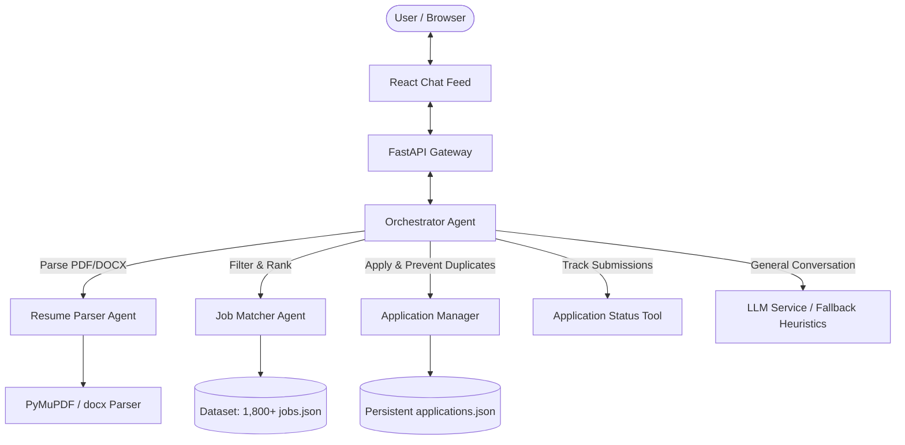

# AI Job Chat Assistant

> A full-stack, agentic AI job assistant: upload your resume, get personalized job recommendations from 1,800+ real job listings with match explanations, refine results via natural conversation, and apply seamlessly.

[](https://aijobassistance.onrender.com)
[](https://aijobassistance-backend.onrender.com)
[](https://github.com/SantoshRajChoudhary/AiJobAssistance)
[](https://python.org)
[](https://fastapi.tiangolo.com)
[](https://react.dev)

---

## 🚀 Live Deployment Links

- **Live Web Application (Frontend)**: [https://aijobassistance.onrender.com](https://aijobassistance.onrender.com)
- **Live Backend API**: [https://aijobassistance-backend.onrender.com](https://aijobassistance-backend.onrender.com)
- **Interactive API Documentation (Swagger)**: [https://aijobassistance-backend.onrender.com/docs](https://aijobassistance-backend.onrender.com/docs)
- **Health Check**: [https://aijobassistance-backend.onrender.com/api/health](https://aijobassistance-backend.onrender.com/api/health)
- **GitHub Repository**: [https://github.com/SantoshRajChoudhary/AiJobAssistance](https://github.com/SantoshRajChoudhary/AiJobAssistance)

---

## 📁 Dataset & Web Scraping

- **Real Job Dataset File**: [`backend/data/jobs.json`](./backend/data/jobs.json) containing **1,800+ real, scraped listings** from active job boards (RemoteOK, Arbeitnow, etc.).
- **Job Scraping Script**: [`backend/scripts/scrape_jobs.py`](./backend/scripts/scrape_jobs.py) (and [`scripts/scrape_jobs.py`](./scripts/scrape_jobs.py)) — automated scraper with pagination, deduplication, schema normalization, and rate limiting.

To run the scraper manually:
```bash
python backend/scripts/scrape_jobs.py
```

---

## 🤖 Agent Architecture

The system uses a modular **Multi-Agent Orchestrator Architecture** separating concerns between intent classification, document parsing, deterministic scoring, application management, and conversational fallback.



### Agent Responsibilities:
1. **Orchestrator Agent** (`backend/app/agents/orchestrator.py`): Classifies user intents (`APPLY`, `APPLICATION_STATUS`, `FILTER_JOBS`, `RECOMMEND_JOBS`, `GENERAL_CHAT`), extracts search filters (skills, remote, titles, locations), and resolves job references (ordinals like *"apply to the second job"*, IDs, or company names).
2. **Resume Parser Agent** (`backend/app/agents/tools/resume_parser.py`): Extracts raw text from PDF (PyMuPDF) and Word documents (python-docx), cleans and structures content into candidate schema: Name, Contact, Designation, Skills, Experience, Education, and Projects.
3. **Job Matcher Agent** (`backend/app/agents/tools/job_matcher.py`): Scores 1,800+ jobs against candidate profile with a transparent formula:
   - **Skills Match**: 50%
   - **Title / Designation Alignment**: 25%
   - **Experience Match**: 15%
   - **Location / Remote Match**: 10%
   - Returns personalized, human-readable match explanations for each listing.
4. **Application Manager** (`backend/app/agents/tools/application_manager.py`): Records applications with `application_id`, `job_id`, `applied_date`, and `status`. Guarantees duplicate prevention.
5. **Application Status Tool** (`backend/app/agents/tools/application_status.py`): Retrieves and summarizes submission history for the candidate.

---

## 🔄 Dataflow

1. **Upload & Parse**:
   - User drops a `.pdf` or `.docx` resume in the chat.
   - Gateway sends file to `POST /api/resume/upload` (or `/api/parse-resume`).
   - Parser Agent validates size, extracts text, and generates structured `ResumeProfile`.
   - UI renders a formatted `ResumeCard` with candidate details and interactive skill chips.
2. **Instant Matching**:
   - Matcher Agent compares parsed profile against the 1,800+ jobs in `data/jobs.json`.
   - Returns top-ranked jobs with match scores and custom explanations.
3. **Conversational Refinement**:
   - User types queries like *"Show only remote roles"* or *"Jobs needing React"*.
   - Orchestrator parses natural language filters and re-ranks results while preserving resume context.
4. **Application Submission**:
   - User types *"Apply to job 2"* or clicks the "Apply" button.
   - Application Manager validates the job ID, checks for duplicates, and writes the record atomically to `applications.json`.
5. **Status Tracking**:
   - User types *"What did I apply for?"* or opens the application drawer to review status.

---

## 📡 API Reference

| Method | Endpoint | Description |
|---|---|---|
| `GET` | `/api/health` | Service health status, storage health, and indexed jobs count |
| `POST` | `/api/parse-resume` | Upload & parse PDF/DOCX resume + return initial matches |
| `POST` | `/api/chat` | Conversational multi-agent endpoint for chat, filtering & apply |
| `GET` | `/api/jobs` | Browse and filter job dataset with pagination & search params |
| `GET` | `/api/jobs/stats` | Aggregated dataset metrics (top skills, top companies, remote %) |
| `GET` | `/api/jobs/{job_id}` | Single job lookup by ID |
| `POST` | `/api/apply` | Apply to a job with duplicate protection |
| `GET` | `/api/applications` | Retrieve list of recorded applications |

Interactive docs available at: [/docs](https://aijobassistance-backend.onrender.com/docs)

---

## 💻 Local Setup Steps

### 1. Prerequisites
- Python 3.11+
- Node.js 18+

### 2. Backend Setup
```bash
cd backend

# Create virtual environment (optional)
python -m venv venv
venv\Scripts\activate  # Windows
# or source venv/bin/activate  # macOS/Linux

# Install dependencies
pip install -r requirements.txt

# Configure environment
cp .env.example .env
# Edit .env and insert your GEMINI_API_KEY (optional, heuristic fallback included)

# Start FastAPI server
python main.py
# Server runs on http://localhost:8000
```

### 3. Frontend Setup
```bash
cd frontend

# Install packages
npm install

# Start Vite dev server
npm run dev
# App runs on http://localhost:5173
```

---

## 🧪 Automated Testing

Run the comprehensive test suite (104 tests):
```bash
cd backend
python -m pytest tests/ -v
```

**Test Coverage Highlights:**
- `test_resume_parser.py`: PDF/DOCX extraction, corrupted file handling, empty file rejection, schema guarantees.
- `test_job_matcher.py` & `test_job_matcher_extended.py`: Composite scoring weights, location scoring, experience level matching, tie-breaking.
- `test_llm_and_orchestrator.py` & `test_orchestrator_extended.py`: Intent classification, filter extraction, ordinal reference resolution, chat fallback.
- `test_storage_session.py`: Thread-safe atomic file writing, corrupt JSON recovery, session isolation.
- `test_api_endpoints.py` & `test_new_endpoints.py`: HTTP routes, query filtering, pagination, stats aggregation.
